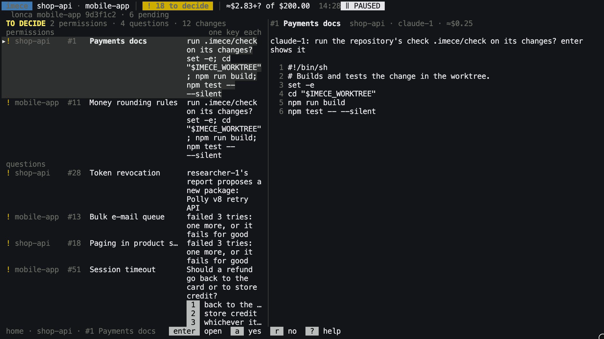

# imece

[](https://github.com/selcukgural/imece/releases/latest)
[](https://crates.io/crates/imece)

**One terminal for a team of Claude Code agents.**

imece (Turkish: neighbours finishing a job together) runs a team of
Claude Code agents on one codebase, on one screen.
A leader reads your checkout and hires workers as the work needs them; each
worker changes a git worktree of its own (or a Lonca workspace) and the
agents talk to each other over a bus. Nothing lands until you have read the
change and said yes to it.

**Documentation, every key and scenario, video tours:
<https://selcukgural.github.io/imece/>** (English · [Türkçe](https://selcukgural.github.io/imece/tr/))

## Install

macOS (arm64, x86_64) and Linux (x86_64, arm64):

```sh
curl -fsSL https://selcukgural.github.io/imece/install.sh | sh   # ~/.local/bin
```

```sh
brew tap selcukgural/imece                                       # Homebrew
brew trust --formula selcukgural/imece/imece                     # Homebrew 7 asks this of every tap that is not its own
brew install imece
```

```sh
cargo install --locked imece                                     # crates.io, Rust 1.99+
```

Each installs the one program, `imece`; it drives
[Claude Code](https://claude.com/claude-code), which must be on PATH and
signed in. `imece doctor` says what else a start needs. Checking a download,
updating and uninstalling:
[Install](https://selcukgural.github.io/imece/docs/getting-started/install).



## What it does

- **A team, not one agent.** The leader splits your request into cards and
  hires workers by tier (cheap, standard, strong), never by model name;
  workers hire helpers for parts of a task. You talk to the leader.
- **Long-lived Claude Code sessions.** Each agent is a session of its own.
  Claude Code's own restrictions are switched on and checked, fail closed.
- **Your checkout changes only when you say so.** A worker's `done` shows up
  as a change (`Δ`) in TO DECIDE: read the diff, note lines, apply all or
  only the hunks you choose, or send it back with your reasons. On Lonca the
  same yes asks the merge queue to land it.
- **One screen to decide on.** Home lists what is to decide, grouped by
  what deciding costs (permissions, questions, changes), each row the whole
  ask with its keys, then who is at work, project by project. A change
  opens with a verdict line: what proved it, whether it stayed inside its
  card's paths, whether it overlaps another change. `W` opens the next from
  anywhere; the terminal's title counts them.
- **Cards that can fail.** A worker may say its card failed; the leader
  hands it again, three tries at most before you say one more or fail it
  for good. A card can wait on others (`after`) and be withdrawn when
  nobody needs it.
- **The leader hears when something is off.** A worker stalled, silent
  mid-turn, idle with no card, or failing the same call again and again is
  told to the leader (`:health` sets the minutes). `:ps` shows each
  session's processes and ends a hung one.
- **One pot.** One budget for the whole team, kept between runs; the
  header shows the pot, how long it lasts when under half an hour is left,
  and a usage window once it is 90% used. `:ledger` says what each try at a
  card cost, what was applied and what was spent for nothing, model by
  model.
- **Lonca underneath, if you want it.** A project can sit on a
  [Lonca](https://github.com/selcukgural/lonca) repository: workers in
  Lonca workspaces, a change a proposal, your yes its approval, Lonca's
  merge queue what merges and verifies it.
- **It remembers.** Projects, cards, conversations and the journal live in
  one SQLite file; agents sleep until you write to them and wake in the
  session they had. Several checkouts at once, each with its own leader.
- **Keyboard first, two languages.** Every action has a key and a `:` name,
  vim style; the screen speaks English and Turkish.

## Run it

```sh
curl -fsSL https://selcukgural.github.io/imece/install.sh | sh   # or brew, or cargo: see Install above
cd your/checkout
imece                                      # a leader reads the checkout and waits for you
imece --agents 8 --budget 10               # up to 8 workers, a $10 pot
imece --demo                               # fake agents, to see the screen at work; costs nothing
```

[Install](https://selcukgural.github.io/imece/docs/getting-started/install) ·
[Download](https://github.com/selcukgural/imece/releases/latest) ·
[First run](https://selcukgural.github.io/imece/docs/getting-started/first-run) ·
[Keys](https://selcukgural.github.io/imece/docs/screen/keyboard) ·
[Scenarios](https://selcukgural.github.io/imece/docs/scenarios) ·
[Videos](https://selcukgural.github.io/imece/docs/videos)

> Status: early, Claude Code only. Researchers are closed, not to be built
> (record 01). Off Lonca, owned paths keep two cards apart, not symbol leases;
> on a project on Lonca the store holds the leases.

The reasons behind each behaviour are in [`docs/decisions/`](docs/decisions);
the site's pages are the Markdown files in `docs/guide/` (English) and
`website/i18n/tr/…` (Turkish).

## Questions and ideas

[Discussions](https://github.com/selcukgural/imece/discussions) is where
to ask and to tell:
[a question](https://github.com/selcukgural/imece/discussions/new?category=q-a),
[an idea](https://github.com/selcukgural/imece/discussions/new?category=ideas)
(start with what happened in a real session: imece takes its features
from there), or
[a session worth showing](https://github.com/selcukgural/imece/discussions/new?category=show-and-tell).
Something broken is an
[issue](https://github.com/selcukgural/imece/issues/new/choose).

## Security

imece guards its own boundaries (who may call which tool, what an agent's
text may do on the screen, the pot, the gate between a worker's work and your
checkout: the Δ review for a worktree, Lonca's approval for a Lonca project)
and is not a sandbox: an agent with a shell can do what your
account can. Please report security problems privately; see
[SECURITY.md](SECURITY.md).

## Sponsors

imece is built by one person, in the open. If it helps your team of agents,
you can help it go on through
[GitHub Sponsors](https://github.com/sponsors/selcukgural): monthly or once.
Sponsors who choose it are listed here.

## License

Licensed under the [Apache License 2.0](LICENSE).
