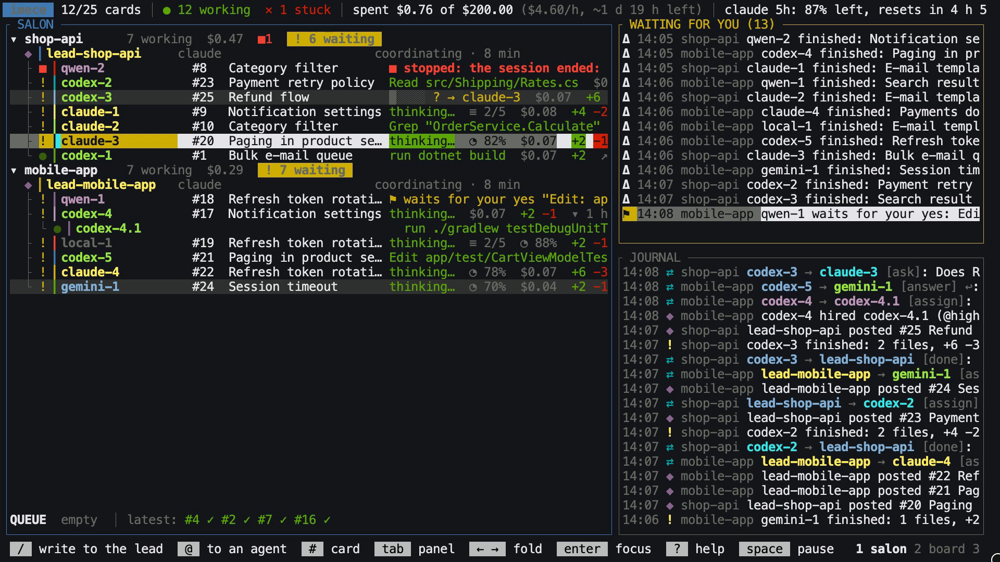

# imece

[](https://github.com/selcukgural/imece/releases/latest)

**One terminal for a team of Claude Code agents.**

imece (Turkish: neighbours finishing a job together) runs a team of
Claude Code agents on one codebase, on one screen.
A leader reads your checkout and hires workers as the work needs them; each
worker changes a git worktree of its own and the agents talk to each other
over a bus. Nothing reaches your checkout until you have read the change
and applied it.

**Documentation, every key and scenario, video tours:
<https://selcukgural.github.io/imece/>** (English · [Türkçe](https://selcukgural.github.io/imece/tr/))

**Install** on macOS or Linux, x86_64 or arm64 (prebuilt, checksum
checked, put on your PATH):

```sh
curl -fsSL https://selcukgural.github.io/imece/install.sh | sh
```

or [download a release](https://github.com/selcukgural/imece/releases/latest)
by hand (`imece-<target>.tar.gz`, with `SHA256SUMS`).



## What it does

- **A team, not one agent.** The leader splits your request into cards and
  hires workers by tier (cheap, standard, strong), never by model name;
  workers hire helpers for parts of a task. You talk to the leader.
- **Long-lived Claude Code sessions.** Each agent is a session of its own.
  Claude Code's own restrictions are switched on and checked, fail closed.
- **Your checkout is never touched.** A worker's `done` shows up as a change
  (`Δ`) in TO DECIDE: read the diff, note lines, apply all or only the
  hunks you choose, or send it back with your reasons.
- **One screen to decide on.** Home lists what is to decide, grouped by
  what deciding costs (permissions, questions, changes), each row the whole
  ask with its keys, then who is at work, project by project. A change
  opens with a verdict line: what proved it, whether it stayed inside its
  card's paths, whether it overlaps another change. `W` opens the next from
  anywhere; the terminal's title counts them.
- **Cards that can fail.** A worker may say its card failed; the leader
  hands it again, three tries at most before you say one more or fail it
  for good. A card can wait on others (`after`) and be withdrawn when
  nobody needs it.
- **The leader hears when something is off.** A worker stalled, silent
  mid-turn, idle with no card, or failing the same call again and again is
  told to the leader (`:health` sets the minutes). `:ps` shows each
  session's processes and ends a hung one.
- **One pot.** One budget for the whole team, kept between runs; the
  header shows the pot, how long it lasts when under half an hour is left,
  and a usage window once it is 90% used. `:ledger` says what each try at a
  card cost, what was applied and what was spent for nothing, model by
  model.
- **Lonca underneath, if you want it.** A project can sit on a
  [Lonca](https://github.com/selcukgural/lonca) repository: workers in
  Lonca workspaces, a change a proposal, your yes its approval, Lonca's
  merge queue what merges and verifies it.
- **It remembers.** Projects, cards, conversations and the journal live in
  one SQLite file; agents sleep until you write to them and wake in the
  session they had. Several checkouts at once, each with its own leader.
- **Keyboard first, two languages.** Every action has a key and a `:` name,
  vim style; the screen speaks English and Turkish.

## Run it

```sh
curl -fsSL https://selcukgural.github.io/imece/install.sh | sh   # macOS, Linux; needs claude on PATH
cd your/checkout
imece                                      # a leader reads the checkout and waits for you
imece --agents 8 --budget 10               # up to 8 workers, a $10 pot
imece --demo                               # fake agents, to see the screen at work; costs nothing
```

[Install](https://selcukgural.github.io/imece/docs/getting-started/install) ·
[Download](https://github.com/selcukgural/imece/releases/latest) ·
[First run](https://selcukgural.github.io/imece/docs/getting-started/first-run) ·
[Keys](https://selcukgural.github.io/imece/docs/screen/keyboard) ·
[Scenarios](https://selcukgural.github.io/imece/docs/scenarios) ·
[Videos](https://selcukgural.github.io/imece/docs/videos)

> Status: early. Researchers are designed, shown by the demo, and not built
> yet; symbol leases (several agents in one file) come from Lonca, for a
> project on it.

The reasons behind each behaviour are in [`docs/decisions/`](docs/decisions);
the site's pages are the Markdown files in `docs/guide/` (English) and
`website/i18n/tr/…` (Turkish).

## Security

imece guards its own boundaries (who may call which tool, what an agent's
text may do on the screen, the pot, the gate between a worktree and your
checkout) and is not a sandbox: an agent with a shell can do what your
account can. Please report security problems privately; see
[SECURITY.md](SECURITY.md).

## Sponsors

imece is built by one person, in the open. If it helps your team of agents,
you can help it go on through
[GitHub Sponsors](https://github.com/sponsors/selcukgural): monthly or once.
Sponsors who choose it are listed here.

## License

Licensed under the [Apache License 2.0](LICENSE).
