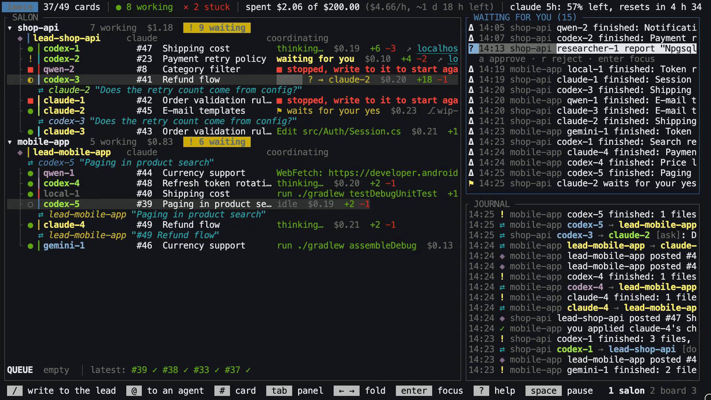

# imece

[](https://github.com/selcukgural/imece/releases/latest)

**One terminal for many coding agents from many vendors.**

imece (Turkish: neighbours finishing a job together) runs a team of coding
agents, Claude Code, Codex and Gemini CLI, on one codebase, on one screen.
A leader reads your checkout and hires workers as the work needs them; each
worker changes a git worktree of its own and the agents talk to each other
over a bus. Nothing reaches your checkout until you have read the change
and applied it.

**Documentation, every key and scenario, video tours:
<https://selcukgural.github.io/imece/>** (English · [Türkçe](https://selcukgural.github.io/imece/tr/))

**Install** on macOS or Linux, x86_64 or arm64 (prebuilt, checksum
checked, put on your PATH):

```sh
curl -fsSL https://selcukgural.github.io/imece/install.sh | sh
```

or [download a release](https://github.com/selcukgural/imece/releases/latest)
by hand (`imece-<target>.tar.gz`, with `SHA256SUMS`).



## What it does

- **A team, not one agent.** The leader splits your request into cards and
  hires workers by tier (cheap, standard, strong), never by model name;
  workers hire helpers for parts of a task. You talk to the leader.
- **Many vendors.** Claude Code, Codex and Gemini CLI run as long-lived
  sessions; Codex may lead while Claude and Gemini work. Each vendor's own
  restrictions are switched on and checked, fail closed.
- **Your checkout is never touched.** A worker's `done` shows up as a change
  (`Δ`) in WAITING FOR YOU: read the diff, note lines, apply all or only the
  hunks you choose, or send it back with your reasons.
- **What needs you, in one place.** A shell command a vendor would have
  asked about (`⚑`), a question from an agent, a finished change: one queue,
  `W` opens the next from anywhere, the terminal's title counts them.
- **One pot.** One budget for the whole team, kept between runs; the header
  shows the burn rate, how long the pot lasts, and each vendor plan's
  tightest usage window.
- **It remembers.** Projects, cards, conversations and the journal live in
  one SQLite file; agents sleep until you write to them and wake in the
  session they had. Several checkouts at once, each with its own leader.
- **Keyboard first, two languages.** Every action has a key and a `:` name,
  vim style; the screen speaks English and Turkish.

## Run it

```sh
curl -fsSL https://selcukgural.github.io/imece/install.sh | sh   # macOS, Linux; needs claude, codex or gemini on PATH
cd your/checkout
imece                                      # a leader reads the checkout and waits for you
imece --agents 8 --budget 10 --lead codex  # up to 8 workers, a $10 pot, Codex leads
imece --demo                               # fake agents, to see the screen at work; costs nothing
```

[Install](https://selcukgural.github.io/imece/docs/getting-started/install) ·
[Download](https://github.com/selcukgural/imece/releases/latest) ·
[First run](https://selcukgural.github.io/imece/docs/getting-started/first-run) ·
[Keys](https://selcukgural.github.io/imece/docs/screen/keyboard) ·
[Scenarios](https://selcukgural.github.io/imece/docs/scenarios) ·
[Videos](https://selcukgural.github.io/imece/docs/videos)

> Status: early. Researchers and symbol leases (several agents in one file)
> are designed, shown by the demo, and not built yet.

The reasons behind each behaviour are in [`docs/decisions/`](docs/decisions);
the site's pages are the Markdown files in `docs/guide/` (English) and
`website/i18n/tr/…` (Turkish).

## Security

imece guards its own boundaries (who may call which tool, what an agent's
text may do on the screen, the pot, the gate between a worktree and your
checkout) and is not a sandbox: an agent with a shell can do what your
account can. Please report security problems privately; see
[SECURITY.md](SECURITY.md).

## License

Licensed under the [Apache License 2.0](LICENSE).
